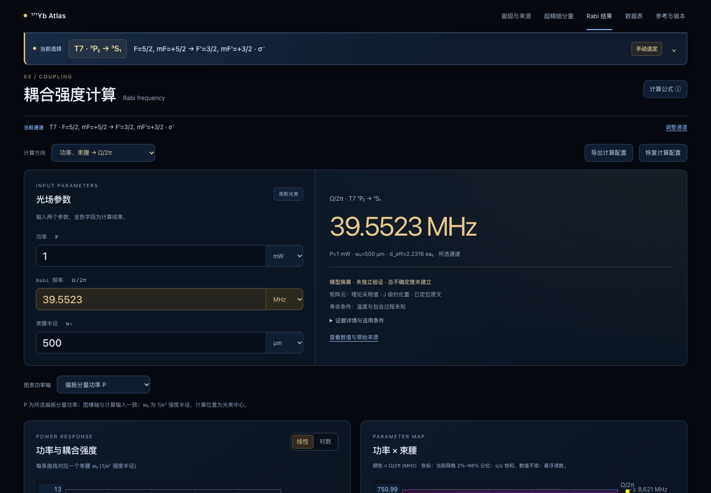

# 其他低能级跃迁的 Rabi–power 核查

核查日期：2026-10-30。当前数据版本2026.10.30.1、公式版本1.0.1。T1、T2、T5、T6、T7 的数值实现与原文理论基准相容，未发现需要更改计算公式或这五条矩阵元的问题。本轮只新增核查证据和测试，没有修改生产物理代码、canonical 原子数据、原始 PDF、保存的65S CSV或主跃迁图。

本结论包括文献理论复现、寿命/分支数据链核对、原始实验或理论矩阵元的交叉检查。**尚未建立新增的、同时具有匹配功率、明确束腰、确定通道及直接实测 Rabi 的独立实验验证。**

## 1. 五条 E1 跃迁的共同基准

固定原文输入：P=1 mW，完整1/e²强度直径 D=1 mm，因此网页的束腰半径 w₀=D/2=500 µm。P 指原子处所选纯偏振分量的功率，采用图表的 P 约定。计算位于高斯光束中心；以下频率均为 Ω/(2π)，单位 MHz。

| 跃迁 | 原文矩阵元 dJ / ea₀ | 所选通道 F,mF → F′,mF′ | 偏振 | 幅度因子 | 计算器 MHz | 原文 MHz | 结论 |
|---|---:|---|---|---|---:|---:|---|
| T1：¹S₀→¹P₁，399 nm | 4.147(4) | 1/2,+1/2 → 3/2,+3/2 | σ⁺ | 1/√3 | 42.435492 | 42.44±0.04 | 在所列不确定度内 |
| T2：¹S₀→³P₁，556 nm | 0.5398(6) | 1/2,+1/2 → 3/2,+3/2 | σ⁺ | 1/√3 | 5.523675 | 5.523±0.006 | 在所列不确定度内 |
| T5：³P₀→³D₁，1389 nm | 2.76(7) | 1/2,+1/2 → 3/2,+3/2 | σ⁺ | 1/√3 | 28.242575 | 28.3±0.8 | 在所列不确定度内 |
| T6：³P₀→³S₁，649 nm | 1.96(15) | 1/2,+1/2 → 3/2,+3/2 | σ⁺ | 1/√3 | 20.056321 | 20.0±1.6 | 在所列不确定度内 |
| T7：³P₂→³S₁，770 nm | 4.99(32) | 5/2,+5/2 → 3/2,+3/2 | σ⁻ | **1/√5** | 39.552267 | 39.5±2.6 | 在所列不确定度内 |

理论基准来源：R. M. Kroeze, S. L. Kristensen, S. Pucher, *171Yb Reference Data*, arXiv:2509.04416v2，[DOI](https://doi.org/10.48550/arXiv.2509.04416)，[官方PDF](https://arxiv.org/pdf/2509.04416v2)。分别定位本地PDF第23页Table8、第24页Table10、第25页Table12和第26页Tables13–14；公式为第16–17页§6.3、式(73)、(78)–(81)。采用原件PDF表号，避免HTML转换版的表号偏移。

原文总述和表中的 Ω₀ 下标声称 π/q=0，但上述明确态对分别有 ΔmF=+1 或−1。按明确态对采用 σ⁺/σ⁻；对同一对态输入q=0，矩阵元应为零。保留这一原文冲突，不通过改变偏振或矩阵元拟合结果。

## 2. 正算、反算和数据链

计算链使用生产函数 `computeDEff` → `spRabi`，没有另外实现一个替代网页的计算器：

```text
I0 = 2P/(πw0²) = 2546.4790894703256 W/m²
E0 = sqrt(2I0/(c ε0)) = 1385.161265789858 V/m
Ω/(2π) = |d_eff| E0/(2πℏ)
```

用原文打印的 Rabi 中心值反算，而非用本函数正算输出做恒等式测试：

| 跃迁 | 反算 P / mW，w₀固定500µm | 反算 w₀ / µm，P固定1mW |
|---|---:|---:|
| T1 | 1.000212 | 499.946892 |
| T2 | 0.999756 | 500.061075 |
| T5 | 1.004071 | 498.985424 |
| T6 | 0.994392 | 501.408035 |
| T7 | 0.997359 | 500.661606 |

打印值的参考区间经反算后，均包含原文1mW和500µm。它们与所用矩阵元属于同一文献数据链，不能将两组不确定度视为统计独立，也不能由此声称完成了实验标定。

进一步按部分跃迁率重建 J 级矩阵元：

```text
A_partial = β/τ
|dJ|² = (2J_upper+1) × 3π ε0 ℏ c³ A_partial / ω³
```

五条的上态J均为1，所以寿命→dJ的简并因子均为3，包括下态J=2的T7。得到dJ分别为4.147493、0.539757、2.760646、1.953050、4.989894 ea₀，均与采用值的打印精度/不确定度相容。T5使用β=0.638，T6使用0.130，T7使用0.508；不能把总Γ=1/τ当作每一支的Einstein A，也不能重复乘β。

T7寿命重建保留原文波长770.160284nm；网页canonical值770.16026840069nm按此前已核对的频率推得。源表的波长冲突继续保留，不因本轮复算覆盖订正值。

另对所有允许F、mF和q求和，每一个固定上态F′,mF′都满足Σ|d_channel|²=dJ²/(2J_upper+1)=dJ²/3，覆盖T7的不同角因子。近循环T1、T2还通过原文Isat进行代数复核，分别得到42.442160和5.523153MHz。开放的1389/649/770nm通道没有套用简单两能级Isat公式。

## 3. 原始文章交叉检查

| 来源 | 核对量 | 原文 dJ / ea₀ | 当前采用值 | 同一基准下对应 Ω/2π / MHz |
|---|---|---:|---:|---:|
| Beloy2012，TableIII，Experiment | ¹S₀↔³P₁ | 0.542(2) | 0.5398(6) | 5.546187 |
| Beloy2012，TableIII，MethodII | ³P₀↔³D₁ | 2.77(4) | 2.76(7) | 28.344903 |
| Porsev1999，TableI，CI+MBPT | ³P₀↔³D₁ | 2.61(10) | 2.76(7) | 26.707652 |
| Porsev1999，TableI，CI+MBPT | ³P₀↔³S₁ | 1.98(10) | 1.96(15) | 20.260978 |
| Porsev1999，TableI，CI+MBPT | ³P₂↔³S₁ | 5.05(20) | 4.99(32) | 40.027845 |

K. Beloy et al., *Determination of the 5d6s ³D₁ state lifetime and blackbody-radiation clock shift in Yb*, Phys. Rev. A86,051404(R)(2012)，[DOI10.1103/PhysRevA.86.051404](https://doi.org/10.1103/PhysRevA.86.051404)，[全文](https://arxiv.org/pdf/1208.0552)。该实验明确使用¹⁷¹Yb，测得τ(³D₁)=329.3±7.1ns、τ(³P₁)=866.1±7.4ns。1389nm的2.77(4)矩阵元还依赖理论LS分支ζ₀=0.64(1)。556、1389nm的矩阵元中心差分别约0.41%、0.36%，但该文章已参与汇编，不称留出的独立实验检验。

S. G. Porsev, Yu. G. Rakhlina, M. G. Kozlov, *Electric-dipole amplitudes, lifetimes, and polarizabilities of the low-lying levels of atomic ytterbium*, Phys. Rev. A60,2781(1999)，[DOI10.1103/PhysRevA.60.2781](https://doi.org/10.1103/PhysRevA.60.2781)，[全文](https://arxiv.org/pdf/physics/9903004)。649、770nm中心差分别约1.02%、1.20%。1389nm旧理论值中心低约5.43%，两边打印不确定度区间有交叠；不能写成与当前采用值完全相同。该理论还关联汇编分支输入，不是独立直接Rabi实验。

## 4. 尚未闭合的实验验证与适用边界

本轮重点核查的候选中，尚未找到完整匹配原子处P、明确1/e²半径w₀、偏振/mF通道和直接实测单光子Rabi的新增案例。具体缺口记录于`cases.json`，这不是对全部文献不存在此类案例的断言。

- McFerran2016的556nm饱和吸收给出约1.2MHz估计，但椭圆泵浦束的匹配功率、两轴半径及直接拟合证据不足；不能移用同文MOT的功率/束腰。
- Beloy2012第4页还描述“至多1mW、30µm spot、I≈7×10⁵W/m²、Ω超过1GHz”的装置量级估计。它没有提供同一确定mF通道的Rabi振荡拟合，不把Ω直接等同于Ω/2π，也不将其作为精确通过/失败判据。
- Qiao2023的649/770nm文章中5ms为光谱探测时间，50µm为晶格光束；不能当作repumper的π时间和束腰。Zhou2020、Zhao2024的空心阴极灯调制转移谱线宽含碰撞和功率展宽，不是冷原子相干Rabi。
- Li2025的1389nm实验报告约2.5mW和约30MHz，但1389nm束腰只有定性描述；不能从目标频率反拟合束腰后再声称验证成功。
- Takasu2004提供399nm寿命的原始实验支持，原子为¹⁷⁴Yb；不能标成¹⁷¹Yb直接Rabi实验。

507nm的T4是M2激发/HFS诱导E1衰变的特殊边界，canonical适用E1矩阵元仍为null，计算器返回`unsupported`，不解释成零耦合。578nm的T3保留[此前独立实验尝试的差异记录](rabi-experiment-validation-20261030.md)，本轮没有调参覆盖。

计算器输出的是束心处裸相干耦合Ω。强衰减、开放分支系统的实际振荡、光泵浦、谱线宽及转移效率还取决于失谐、衰减、多能级动力学、运动与空间平均；不能仅凭理想π时间宣称实验效率或门保真度。

## 5. 文件与复现

- [原始参数与文献索引](../../data/literature/low-state-rabi-validation-2026-10-30/cases.json)
- [生产函数复算脚本](../../data/literature/low-state-rabi-validation-2026-10-30/reproduce.mjs)
- [完整复算结果](../../data/literature/low-state-rabi-validation-2026-10-30/results.json)及[汇总CSV](../../data/literature/low-state-rabi-validation-2026-10-30/summary.csv)
- 原文PDF SHA-256在`cases.json`中逐篇保存，脚本运行时核验；保护哈希另覆盖主图、canonical数据、生产物理代码及保存的65S CSV。

```sh
node data/literature/low-state-rabi-validation-2026-10-30/reproduce.mjs
node --test tests/physics/low-state-rabi.test.js
npm run check
npx playwright test tests/e2e/low-state-rabi.spec.js
```

核查记录：新增18项数值/证据测试通过；`npm run check`共206项单元测试、数据校验、构建及产物检查通过。Chrome在1440px、1024px和390px三种视口共15个用例通过；每条都实际选择主图跃迁及CG表mF通道，并核对顶部标记、正算和两个反算方向，未发生页面脚本或资源请求错误。文献原件和本地核查数据继续排除在发布产物之外。


