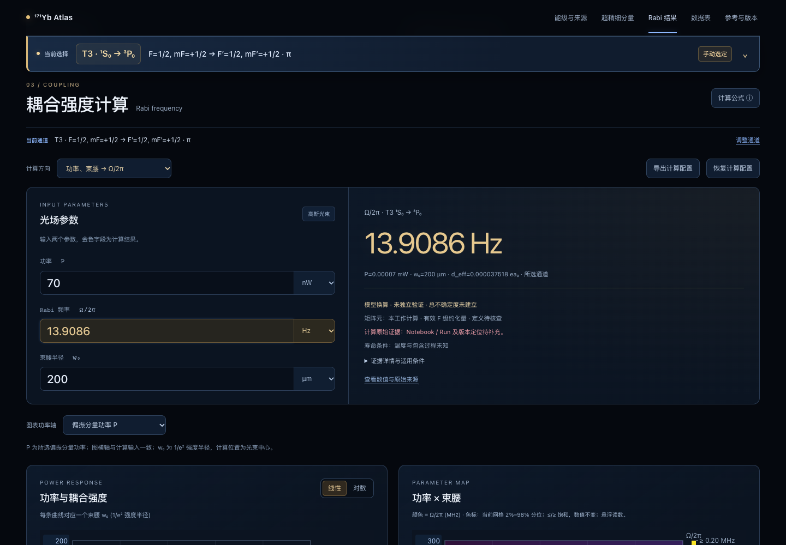

# Rabi-power 独立实验对照：尚未建立通过结论

日期：2026-10-30。与前一份 Kroeze 理论表格复现分开记录。本轮检索确认了一篇同时给出实验功率、束腰和 Rabi 工作频率的171Yb文章，并完成另一篇已报告功率/束腰/π时间的辅助操作点复算。严格的绝对 Rabi 独立实验验证尚未完成。

没有修改 canonical 数据、任何跃迁矩阵元、Rabi 正式计算公式或主跃迁图；没有把其他 n/F 分支的矩阵元移入实验态，没有利用目标 Rabi 值反向拟合验证输入。

## 1. 三项实验参数齐全的主文献

Michael Peper et al., *Spectroscopy and Modeling of 171Yb Rydberg States for High-Fidelity Two-Qubit Gates*, **Physical Review X15,011009(2025)**。

- DOI：[10.1103/PhysRevX.15.011009](https://doi.org/10.1103/PhysRevX.15.011009)。
- [开放原文](https://arxiv.org/abs/2406.01482)。
- 本地原件：`references/papers/2025_Peper_171Yb_Spectroscopy-modeling_published.pdf`。
- SHA-256：`ca3fb39f0b6245d8d09def6deee9d62849dd6300e222c3d1a0dbf132aa3ee24a`。
- 原文位置：§V，011009-9至011009-10页；Fig.18，011009-23页。

| 参数 | 原文实验条件 |
|---|---|
| 同位素 | 中性171Yb |
| 光学跃迁 | ³P₀,mF=+1/2 → triplet-connected ν≈54.28,L=0,F=1/2,mF=−1/2 |
| 波长 | 约302 nm |
| 总功率 | 20 mW |
| 束腰 | 12 µm，1/e²强度半径 |
| 偏振 | 垂直磁场的线偏振 |
| 驱动目标通道的功率 | 10 mW，原文明确仅一半功率驱动σ⁻ |
| 实验报告 Ω/2π | 2.5 MHz |

这些是实验操作段落给出的工作值，原文在该处没有联合列出功率、束腰和 Rabi 的误差预算。不能将未知误差记为零，也不能假定已补偿所有光路损耗。

### 为什么还不能独立判定绝对数值一致

绝对 Rabi 换算还需要**相同实验态、磁场、偏振通道的独立有效偶极矩阵元**。当前网页R2保存的是n=65矩阵元，不能用于此ν≈54.28的F=1/2态；也不能仅凭n、F或经验n⁻³ᐟ²标度视为同一分支。

原文Fig.18提供了从³P₀到不同Rydberg态的计算矩阵元图，已经包含具体F/mF角向依赖，不能再乘一次CG。该图的原始数值、固定生成版本、与实验场的对应尚未闭合；式(A22)的rᵏYₖq记法和物理偶极erC¹q的归一化也需与生成程序逐项确认。故没有将读图数值当精确d_eff代入，更没有从2.5MHz反推d_eff再“验证”回同一个值。

目前正式接口对这组外部实验态返回`missing-data`，预测值和残差保留`null`。结论是**独立验证尚未完成**，不是“一致”，也不是“计算器被证伪”。

## 2. 可实际复算的辅助时钟操作点

Marco Pizzocaro et al., *Absolute frequency measurement of the 1S0-3P0 transition of171Yb*, **Metrologia54,102-112(2017)**。

- DOI：[10.1088/1681-7575/aa4e62](https://doi.org/10.1088/1681-7575/aa4e62)。
- [官方arXiv v2 PDF，第4页§II.E](https://arxiv.org/pdf/1609.01610v2#page=4)。
- 已下载新原件：`references/papers/2017_Pizzocaro_171Yb_Absolute-frequency_arXiv1609.01610v2.pdf`，未覆盖任何已有文件。
- SHA-256：`1d20e391c49bd9e9af8adeebfeccf7580a12c71d636aff44616f139a4951bfbc`。

| 项目 | 原文或当前计算 |
|---|---|
| 跃迁/通道 | T3，¹S₀→³P₀，F=1/2,mF=±1/2 →相同mF，π偏振 |
| 入射功率 | 70 nW =0.000070 mW |
| 束腰 | 200 µm，1/e²强度半径 |
| 偏置磁场 | 正文约0.14mT；Fig.3谱线示例标为0.13mT |
| 实验所述π时间 | 60 ms |
| 从π时间换算的名义Ω/2π | 1/(2tπ)=8.333333 Hz |
| 当前T3有效F约化矩阵元 | 9.19×10⁻⁵ea₀，来源仍为未闭合的内部记录 |
| 当前π通道d_eff | 9.19×10⁻⁵/√6=3.751801789×10⁻⁵ea₀ |
| 正式函数预测Ω/2π | 13.9086427105 Hz |
| 正式函数预测tπ | 35.9488708142 ms |
| 相对名义π时间换算值的差异 | +66.9037125% |

这是**名义操作点数值不一致**。60ms是原文所述操作π时间，不是另列的Rabi振荡拟合结果；全文没有给这一比较所需的功率/束腰/π时间完整误差预算。原文典型谱宽20Hz由时钟激光频率噪声限制，典型温度7(3)µK、晶格深度200Er；当前计算器是光束中心的理想单光子幅度换算，并未建立相应运动、空间平均和噪声修正。因此不能仅凭66.9%的差异确定哪个量有误，也不能将其升级为严格实验验证失败或通过。

## 3. 其他候选文献的排除依据

| 文献 | 没有采用的原因 |
|---|---|
| Lis et al., PRX13,041035(2023) | 约110kHz和20µm可定位，但90mW为倍频源输出，未闭合到同一测量的原子处功率。 |
| Muniz et al., PRX Quantum6,020334(2025) | 时钟束腰400×35µm、Rabi3–15kHz可定位；未找到同一操作点功率。 |
| Wang et al., CPB31,090601(2022), DOI10.1088/1674-1056/ac5392 | 5mW属于边带冷却路，Fig.5的310Hz属于另一探测路，不能拼成一组。 |
| Senoo et al., Nature Physics(2026), DOI10.1038/s41567-026-03258-8 | 200mW是UV源输出；1mW、40µm是369.5nm自电离探测光，不能用于时钟或Rydberg Rabi。 |
| Li et al., arXiv2502.17406v2 | 1389nm约2.5mW、约30MHz可定位，但相应束腰只给“比35µm时钟束腰大数倍”。 |

## 4. 文件与复现

- 原始提取及适用性记录：`data/literature/rabi-experiment-validation-2026-10-30/cases.json`。
- 正式函数复算与证据状态：同目录`results.json`。
- 重生成：`node data/literature/rabi-experiment-validation-2026-10-30/reproduce.mjs`，先检查两个原文PDF哈希，再调用当前正式函数；不运行MQDT。
- 数值记录回归：`node --test tests/physics/rabi-experiment.test.js`。
- 页面回归：`npx playwright test tests/e2e/rabi-experiment.spec.js`，核对T3、π通道、70nW、200µm对应13.9086Hz，并保留“未独立验证”标记。

测试通过表示复算和证据边界被正确保留，不表示实验验证通过。要关闭主文献基准，还需固定Peper实验态的独立物理d_eff原始数值、生成/测量证据及适用场条件；随后以10mW、12µm比较2.5MHz，给出完整不确定度。

工程检查：188项数值、数据及界面单元测试和构建/产物检查通过；1440px、1024px及390px的3个Chrome页面用例通过。原始31份PDF及主图/保存65SCSV保护哈希检查通过；新下载Pizzocaro原件由本次独立SHA-256记录保护。

下图为辅助T3操作点的网页输出，**不是Peper实验态的预测或实验验证通过证据**。

