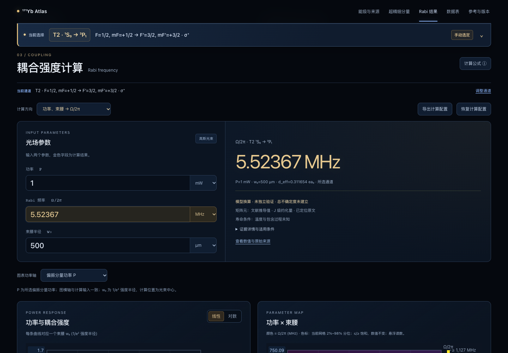

# Rabi-power 计算器文献理论基准核对

核对日期：2026-10-30。结论：当前 T2 通道的功率/束腰/Rabi 正算及反算与论文理论数值相容。证据类别为文献理论数值复现；未建立独立实验标定或总物理不确定度。没有修改矩阵元来拟合目标值，也未修改任何主跃迁图代码、canonical 科研数据或原文 PDF。

## 原文与核对位置

Ronen M. Kroeze, Sofus Laguna Kristensen, Sebastian Pucher, *171Yb Reference Data*, arXiv:2509.04416v2，PDF dated February 16, 2026。DOI：[10.48550/arXiv.2509.04416](https://doi.org/10.48550/arXiv.2509.04416)。

- [官方 PDF，第24页 Table 10](https://arxiv.org/pdf/2509.04416v2#page=24)：T2 矩阵元、指定态对、功率/直径及目标 Rabi 频率。
- 第16-17页 §6.3，式(73)、(78)-(81)：高斯峰值强度、直径/半径和 Rabi 定义。
- 本地原件：`references/papers/2026_Kroeze_171Yb_Reference-data_arXiv2509.04416v2.pdf`。
- 原件 SHA-256：`4ffbcc4a8fade841f0f053392617abd4fa05fd501bbe5325ebaf0246d5bcd200`。
- 当前 arXiv HTML 转换版将对应表编号为 Table 11；本核对固定引用与本地原件相符的官方 PDF Table 10，避免表号混淆。

## 原始数据和网页输入

| 物理量 | 原文或正确输入 |
|---|---|
| 原子与跃迁 | 171Yb，¹S₀→³P₁，555.80068663 nm，网页 T2 |
| 通道 | F=1/2,mF=+1/2 → F′=3/2,mF′=+3/2 |
| 偏振 | σ⁺，q=+1，ΔmF=+1 |
| 功率 P | 1 mW，纯 σ⁺ 分量，图表功率轴采用 P |
| 原文光束直径 D | 1 mm，完整 1/e² 强度直径 |
| 网页束腰半径 w₀ | D/2=500 µm |
| J 级约化矩阵元 | 0.5398(6) ea₀；当前数据库相同 |
| 角向幅度因子 | 1/√3 |
| 有效矩阵元 | 0.3116536753085599 ea₀ |
| 原文 Ω/2π | 5.523(6) MHz，即5.523±0.006 MHz |

原文第17页总述及表中 Ω 的下标写 q=0/π，但指定态对 ΔmF=+1；对吸收通道必须采用 σ⁺。这里保留冲突、按明确态标签核对。对同一指定态对强行采用 π，矩阵元为零；合法的 π 通道 mF′=+1/2 对应4.510061452 MHz，不能与表中伸展态结果混用。

## 复算与比较

正式计算链：`computeDEff` 的 J→F 及 CG 因子 → `spRabi`。高斯光束中心、单光子 E1 耦合：

```text
I0 = 2P/(πw0²) = 2546.4790894703256 W/m²
E0 = sqrt(2I0/(cε0)) = 1385.161265789858 V/m
Ω/(2π) = |d_eff| E0/(2πℏ) = 5.523674633289015 MHz
```

与打印中心值之差为+0.000674633289015 MHz，即+674.633 Hz、+0.012214979%；小于论文所列0.006 MHz。不将同一文献推导得到的矩阵元和 Rabi 不确定度当成两个独立数据集，也不据此进行独立显著性检验。

用论文打印值5.523 MHz反算：

| 计算方向 | 网页/正式函数结果 | 原文输入 |
|---|---|---|
| P,w₀→Ω/2π | 5.523674633 MHz，网页显示5.52367 MHz | 5.523(6) MHz |
| Ω/2π,w₀→P | 0.9997557452 mW | 1 mW |
| P,Ω/2π→w₀ | 500.0610749 µm | 500 µm |

反算差异来自使用论文打印的 Rabi 中心值，均在参考精度允许范围内。页面验证通过真实 CG 表选择通道并填写功率/束腰；没有通过注入输出值替代计算。

## 验证边界与复现

本例覆盖 T2 指定通道的角因子、高斯峰值强度、半径/直径、mW/µm 单位、Ω 与 Ω/2π、三种计算方向及页面状态传递。它不验证所有跃迁的原子数据，不为 T3/R2 未闭合矩阵元背书，也未加入有限磁场混合、失谐、运动平均或退相干。

- 数据：`data/literature/rabi-power-validation-2026-10-30/kroeze-table10.json`。
- 数值回归：`node --test tests/physics/rabi-literature.test.js`。
- 页面回归：`npx playwright test tests/e2e/rabi-literature.spec.js`。
- 数据版本2026.10.30.1，公式版本1.0.1，软件0.2.0，本地未发布。

实际检查：`npm run check` 的186项测试及构建/产物检查通过；Chrome的1440px、1024px和390px三个页面用例全部通过，每个用例均操作真实通道及三个计算方向。主图与原文PDF的保护哈希检查也通过。


